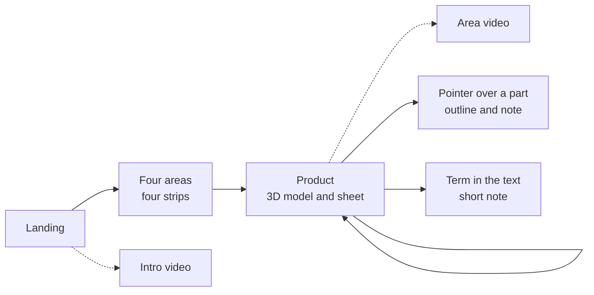

<p align="center"></p>

# INVAP 2071

A guided visit to four products that INVAP could be building fifty years from now, made in collaboration with INVAP.

INVAP is a state-owned Argentine technology company, founded in 1976 in San Carlos de Bariloche. It designs and builds research nuclear reactors, satellites and radars. This project imagines its role in a distant future: how people will live on other worlds, travel between them, stay in touch and produce the energy to do it.

## What is in it

Four areas, each with one product shown as a 3D model you can turn:

| Area | Product | What it is |
|---|---|---|
| Habitat | Elmapu | A pressurised dome holding a closed ecosystem: crops, a forest and a pond |
| Transport | Patoruzú | An interplanetary cargo ship with gravity rings and ion engines |
| Communication | Mafalda II | A relay satellite: radio in, laser links out |
| Energy | Antu Reactor | A compact fusion reactor with four radiators |

Patoruzú and Mafalda are named after classic Argentine comic characters.

The copy is held to what fifty years could plausibly bring. The destinations are the Moon and Mars. Nothing travels faster than light: a signal between the Earth and Mars takes 3 to 22 minutes, and quantum entanglement is used only to share encryption keys. A reactor in a vacuum sheds its heat through radiators.

## How it works



- **Three scenes.** The landing, the four areas and a product. The address carries the scene (`#areas`, `#energy`), so a product can be linked to and the back button works.
- **Videos are opt-in.** Moving between scenes is immediate. The intro video and each area's video open over the page from a button and close back to it.
- **The model names its own parts.** Sixteen parts across the four models answer to the pointer: each has a faint green outline, and the one under the pointer turns bright and opens a note with its name and what it does. Each part has its own outline pass, because one pass draws round everything it is given as a single shape.
- **Finding the part under the pointer.** A ray is cast into the model and the nearest named part wins. Glass and laser beams are looked through. Parts made of thin pipes also answer within 9 px. Every mesh carries an index of its triangles ([three-mesh-bvh](https://github.com/gkjohnson/three-mesh-bvh)), so a check reads a few dozen triangles instead of the ship's 200,000.
- **Terms explained.** Fourteen scientific terms in the descriptions (fusion, plasma, regolith, quantum entanglement and others) open a short note in plain language.
- **Shaders.** The reactor's chambers are a plasma shader, and the satellite's laser links are beams with packets of light running along them.

## Stack

- React 18 and Vite
- Three.js: GLTF with Draco compression, an environment map for reflections, ACES tone mapping, bloom and outline passes
- three-mesh-bvh for pointer checks
- Models built and textured in Blender

## Running it

```bash
npm install
npm run dev
```

Opens on http://localhost:5190. `npm run build` writes the site to `dist`.

## Credits

- **Elmapu** and **Mafalda II** were modelled in Blender for this project.
- **Patoruzú** and the **Antu Reactor** start from third-party meshes that were part of the original 2021 build (`WarpShip.obj`, `Reactor.obj`). I do not know their original licence; if one of them is yours, open an issue and I will credit or remove it.
- Surface textures are from [Poly Haven](https://polyhaven.com) (CC0): `metal_plate_02`, `blue_metal_plate`, `red_laterite_soil_stones`, `aerial_grass_rock`.
- The typeface is [Archivo](https://fonts.google.com/specimen/Archivo). The INVAP wordmark belongs to INVAP.
- The videos are from the original 2021 build and are in Spanish.
