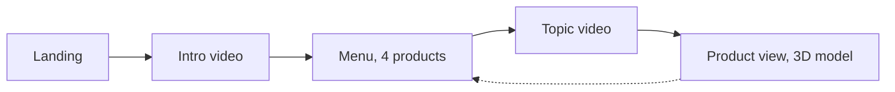

# INVAP Interactive Experience

A speculative sci-fi concept site that imagines INVAP, the real Argentine high-tech company, as a maker of interstellar hardware. This is a personal concept piece. It is not client work and is not affiliated with or commissioned by INVAP. I built it as a design-and-web exercise: take a company I admire and project its engineering culture a few centuries forward.

## What it is

INVAP builds real satellites, reactors, and radar systems here on Earth. This project asks what their catalog might look like once humanity is colonizing the solar system, and presents four fictional product lines as a guided, cinematic experience:

- Energia: the Antu compact fission reactor for ships and small stations
- Transporte: the Patoruzu cargo vessel, built with a hybrid Earth and lunar-orbit assembly process
- Habitat: the Elmapu ecological domes for terraforming
- Comunicacion: the Mafalda II satellite, which in the fiction beats the speed of light with quantum entanglement

The product names are a wink at Argentine culture (Patoruzu and Mafalda are classic comic characters). All of the copy is invented and clearly fictional. The point is the mood and the interaction, not a real spec sheet.

## How it works

The experience is a single React app driven by one piece of state, a `showVideo` step counter that walks you through five scenes: an animated landing, an intro film, a four-option menu, a per-topic video, and a product detail view. Framer Motion handles the entrances, full-screen videos carry the transitions, and the final scene embeds a rotating 3D model.



### The 3D model viewer

The one non-trivial technical piece is the product viewer. Even though the project pulls in react-three-fiber, the model is rendered with raw Three.js inside a React class component (`RenderBox`): it builds its own scene, perspective camera, and three point lights in `componentDidMount`, mounts the WebGL canvas through a React ref, and loads a `.obj` with `OBJLoader`. Once the object is in, it grabs the named mesh, recolors it emerald, and runs a manual `requestAnimationFrame` loop that nudges the rotation each frame, with OrbitControls so you can spin it by hand. Doing it directly rather than through the r3f abstraction is more code, but it made the load-progress callback and the exact light and material tweaks easy to reason about, which is what I wanted while learning the library.

## Tech stack

- Frontend: React 17 (Create React App), Material-UI, Framer Motion
- 3D: Three.js (OBJLoader, OrbitControls), with react-three-fiber present
- Media: pre-rendered MP4 scene videos and `.obj` models in `public`

The interface copy is in Spanish.

## Running it

```bash
yarn install
yarn start
```

Opens on http://localhost:3000.

## Status

A personal concept and design piece, built around 2021 as speculative brand fiction. Not affiliated with INVAP. The lead-capture modal at the end ("¡Queremos conocerte!") is part of the fiction, with placeholder text.
