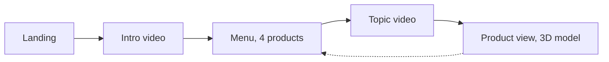

# INVAP Interactive Experience

A speculative sci-fi concept site that reimagines INVAP, the real Argentine high-tech company, as a builder of interstellar hardware. This is a personal project. It is not client work and has no affiliation with INVAP. I made it as a design-and-web exercise: take a company I admire and push its engineering culture a few centuries into the future.

## What it is

INVAP builds real satellites, reactors, and radar systems here on Earth. The project imagines their catalog once humanity is colonizing the solar system, and lays it out as a guided, cinematic experience with four fictional product lines:

- Energia: the Antu compact fission reactor for ships and small stations
- Transporte: the Patoruzu cargo vessel, built with a hybrid Earth and lunar-orbit assembly process
- Habitat: the Elmapu ecological domes for terraforming
- Comunicacion: the Mafalda II satellite, which in the fiction beats the speed of light with quantum entanglement

The product names are a wink at Argentine culture (Patoruzu and Mafalda are classic comic characters). All the copy is invented and openly fictional. What I cared about was the mood and the interaction.

## How it works

The whole thing is one React app driven by a single piece of state: a `showVideo` counter that steps through five scenes. Landing, intro film, a four-option menu, a per-topic video, then a product detail view. Framer Motion handles the entrances, full-screen videos carry the transitions, and the last scene embeds a rotating 3D model.



### The 3D model viewer

The product viewer is the one piece with real code behind it. `RenderBox` is a React class component that drives Three.js by hand. In `componentDidMount` it builds its own scene, a perspective camera, and three point lights. It mounts the WebGL canvas through a React ref and loads a `.obj` with `OBJLoader`. When the model arrives, it grabs the named mesh, paints it emerald, and starts a `requestAnimationFrame` loop that nudges the rotation each frame. OrbitControls let you spin it yourself. The project has react-three-fiber available, but I wrote this the manual way on purpose. I was learning the library. Hand-wiring the load-progress callback, the lights, and the materials myself kept every step easy to follow.

## Tech stack

- Frontend: React 17 (Create React App), Material-UI, Framer Motion
- 3D: Three.js (OBJLoader, OrbitControls), with react-three-fiber present
- Media: pre-rendered MP4 scene videos and `.obj` models in `public`

The interface copy is in Spanish.

## Running it

```bash
yarn install
yarn start
```

Opens on http://localhost:3000.

## Status

A personal concept and design piece, built around 2021 as speculative brand fiction. It has no affiliation with INVAP. The lead-capture modal at the end ("¡Queremos conocerte!") is part of the fiction, with placeholder text.
